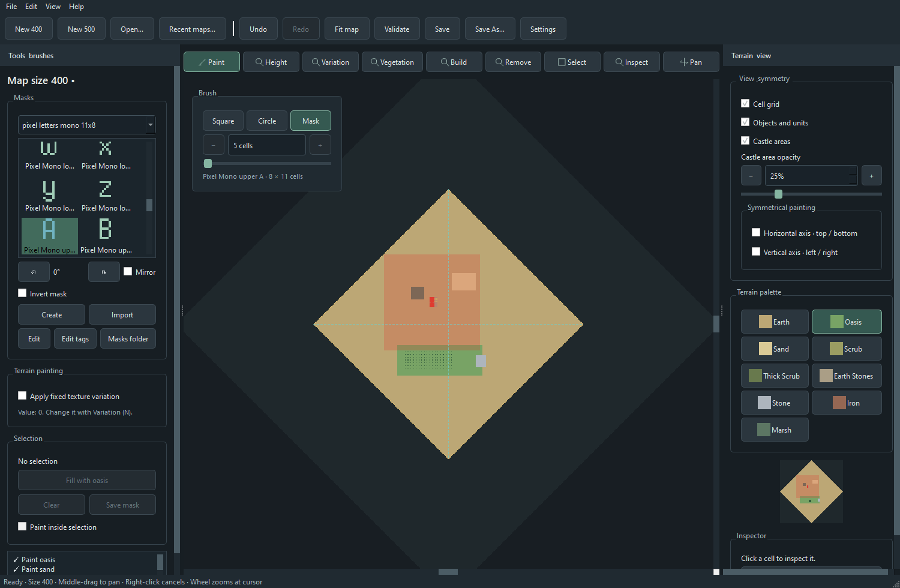
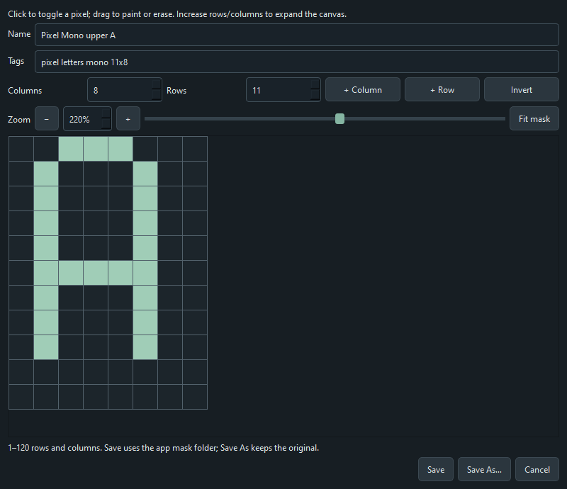
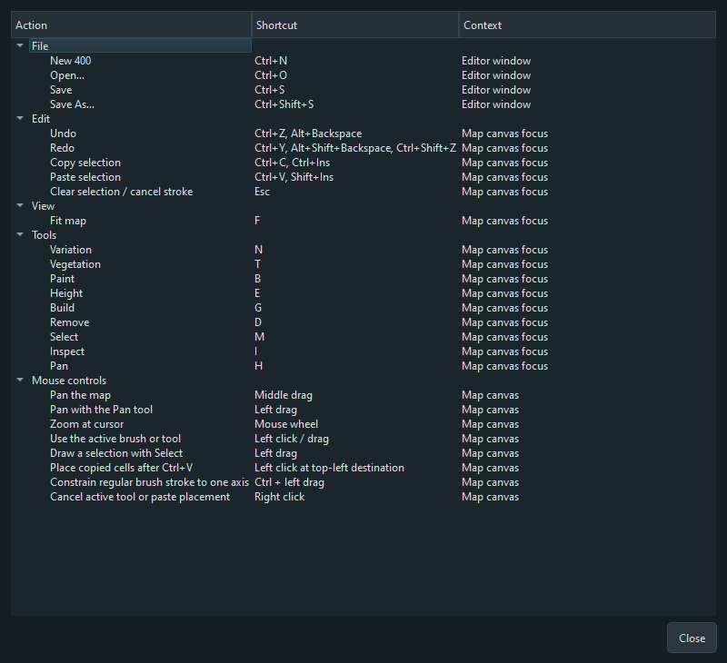

# SHC DE Map Editor

A portable, 2D map editor for **Stronghold Crusader: Definitive Edition** on Windows. Paint native-size maps from 160 to 800 with square, circle, and custom pixel masks; mirror brush strokes across the map; edit terrain height and texture variation; place vegetation and selected buildings; copy map data between regions; and undo or redo your changes. The canvas shows the map as a top-down cell grid so you can work precisely.

## Get started — no build required

1. Open this repository's **Releases** page and download **`SHCDEMapEditor.exe`** from the latest release assets.
2. Run the EXE on Windows x64. It is a single portable file: you do **not** need to install Python, Qt, or the source repository.
3. Choose **160, 200, 300, 400, 500, 600, 700, or 800** and click **New map**, or use **Open…** to load a `.map` file. The editor can also open a `.msv` save for research or editing; use **Save As…** to export it as a `.map`.
4. Edit the map, then use **Save As…** to choose a `.map` filename. To make it available in the game, save it in the game's `Maps` folder. **Save** updates the current map after a replacement warning.
5. **Recommended:** open your exported map in the game's own **Map Editor** and save it there once, then test it in game. Maps may load directly without this step, but a native resave can rebuild game-specific data that this editor does not yet fully understand. This is especially useful after building castles or changing heights.

New empty maps contain no player castles. Add the castles you need before expecting a playable match.

Your settings, recent paths, and masks are stored under `%APPDATA%\SHCDEMapEditor`; they are separate from the EXE. On first launch the app adds 186 built-in letter and digit masks to `Patterns`. It adds missing defaults on later launches without overwriting masks you edited or created.

## Guide

### Find your way around

| Area | What it contains |
| --- | --- |
| Top document bar | New/Open, recent maps, Undo/Redo, Fit map, Validate, Save/Save As, and Settings. |
| Row above the map | Paint, Height, Variation, Vegetation, Build, Remove, Select, Inspect, and Pan. |
| Map top-left | Square/Circle/Mask brush choice and brush-size controls when a brush tool is active. |
| Map top-right | Height or Variation value and slider when that tool is active. |
| Left panel | Mask library and tags, tool-specific options, selection actions, and undo history. |
| Right panel | View and symmetry options, terrain palette for Paint, building list for Build, overview, and inspector. |

The colored diamond is the playable map; the dark outer area is storage padding. Dashed center lines are always visible. Use the mouse wheel to zoom at the pointer, **middle-drag** to pan, or **Fit map** to see the whole map. The **Pan** tool also pans with left-drag. Right-click cancels the current tool or paste placement and returns to Inspect.

### Paint terrain

Choose **Paint (B)**, pick a terrain swatch on the right, and click or drag on the map. Available swatches include Earth, Oasis, Sand, Scrub, Thick Scrub, Earth Stones, Stone, Iron, Marsh, Sea, River, Ford, Beach, Pitch, Rocks, Middle Plateau, and High Plateau. Repaint with another terrain to change a cell. Marsh is passable ground that cannot be built on. Stone and iron represent resources.

The brush can be **Square**, **Circle**, or **Mask**. For square and circle brushes, use `−`, `+`, the slider, or type an exact size; the range is 1 to the selected map size. A mask keeps its own pixel dimensions, regardless of the brush-size setting. Hold **Ctrl while dragging** a regular brush to keep a straight horizontal or vertical stroke.

Paint skips buildings, units, vegetation, unknown object flags, and map borders. Ordinary textures work on hills and preserve their elevation. Sea/beach set height 0; river/ford lower the water surface relative to the base terrain. Each completed stroke is one undoable edit. **Apply fixed texture variation** in the left panel also paints the currently selected Variation value along with the terrain.

### Height and texture variation

**Height (E)** paints the selected elevation. The value control above the map accepts 0–255; ordinary ground starts at 8. Values below 8 or above 130 turn red and trigger a warning because those ranges need extra in-game checking. Current and base terrain heights change together. Movement edges and connected regions are rebuilt with the native rules after each terrain, building, or vegetation edit. **Edit → Rebuild navigation** also refreshes an imported map. Navigation updates are included in Undo/Redo. Terrain artwork and cliff rendering still need an in-game check. The Height view uses a fixed color scale rather than rescaling colors for each map.

**Variation (N)** paints a texture variation number from 0–65535. Its grayscale view shows the stored values: darker means lower, lighter means higher. Variation can also be applied while painting terrain using the checkbox described above. The visual effect of a variation value can depend on surrounding terrain in the game.

### Use masks and patterns

The left panel's mask gallery has an **All / Untagged / tag** filter. Choose a thumbnail, then paint with **Mask** selected. Built-in masks include uppercase letters, lowercase letters, and digits in Pixel Operator Mono, Pixel Operator Mono Bold, and Perfect DOS VGA 437 styles. Binary masks contain painted/empty cells: choose the terrain separately. Height masks also store an elevation for every painted cell and automatically activate Height. A height of 0 is valid and distinct from a transparent cell. Rotate, Mirror, and **Invert mask** transform a stamp while leaving its saved source intact.

**Create** makes a binary or height mask. **Import** accepts JSON or Pillow-supported images, including PNG, JPEG, BMP, WebP, TIFF and GIF, at arbitrary source dimensions. Choose output width/height (1–800 cells), contain/crop/stretch fitting, brightness and transparency thresholds, inversion, and optional contrast normalization. In Height mode, brightness maps into your chosen elevation range. A preview updates before import; output settings are remembered. The mask editor opens before saving. Masks can be up to **800 × 800** cells.

Right-click a gallery thumbnail for **Edit tags** or **Edit mask**. In the mask editor, click or drag to change pixels, add rows or columns, invert the mask, and zoom or fit large masks. **Save** updates that mask and closes the editor; **Save As…** asks for a new name and tags, keeping the original. The app saves masks in its own `Patterns` folder, so no folder selection is needed. The **Masks folder** button opens that location. You can also use **Select → Save mask** to capture terrain coverage, or capture per-cell elevations while Height is active. Height-mask inversion reverses elevations within the stored range; it preserves coverage.

### Mirror brush strokes

In the right panel, enable **Horizontal axis** to reflect top ↔ bottom, **Vertical axis** for left ↔ right, or both for four-way symmetry. This affects terrain, height, variation, and vegetation strokes. The options remain visible when another tool is active, but building placement and removal do not mirror. Paint inside selection, when enabled, clips mirrored edits to the selection.

### Select, fill, and copy map data

Choose **Select (M)** and drag a rectangle. The left panel can **Fill selection** with the current terrain, height, or variation value, **Clear** the selection, **Save mask** from its painted cells, or enable **Paint inside selection**. Fill and copy operations skip unsupported or protected cells.

For exact per-cell copying, select a rectangle on the layer you want and press **Ctrl+C**. Press **Ctrl+V**, then click the **top-left destination cell**. The preview uses the original rectangle size; brush size, masks, and symmetry do not affect it. Surface copies terrain plus its variation and supported terrain flags, Height copies height values, and Variation copies variation values. This clipboard is for map data inside the running editor; it does not copy buildings or units. Paste is one undoable operation, and **Esc** cancels placement.

### Vegetation, buildings, and removal

**Vegetation (T)** offers oak, pine, chestnut, birch, and several shrub types. Click or drag to plant; the tool spaces trees along strokes and respects symmetry. Occupied or unsuitable cells are skipped.

Choose **Build (G)**, select a building from the right panel, choose its owner with the colored **P1–P8** buttons on the left, and click the map. The preview is green where the building fits and red where it cannot be placed. The catalog contains 69 presets, including houses, food/storage buildings, farms, workshops, resource buildings, churches/cathedral, market, military camps and parade grounds, guilds, stables, gardens and fear buildings, gates, drawbridges, walls, stairs, towers, and a complete castle group. Use the name filter or category selector to find one. A castle includes its keep, campfire, stockpile, and lord. Only actual occupied/support cells are reserved: empty corners inside the enclosing rectangle remain buildable. The initial castle geometry uses the known reference orientation.

With **Castle areas** enabled in the right panel, an existing castle shows its player-colored wall-building area. When positioning a new castle, the same translucent area follows the preview so you can choose its location before placing it. The radius is selected from the native table: 45/50/60/70/80/90/100/100 cells for sizes 160/200/300/400/500/600/700/800. The square is centered on the keep access tile. Adjust **Castle area opacity** with the nearby slider. This is a range guide; terrain and other game rules still apply.

**Castle terrain clearing** marks in amber the area that starting-castle recreation may repaint when the game loads the map. The mark follows placement and also shows around existing castles. It never changes your terrain. The native brush extends around both the keep and campfire; the result also depends on occupied cells, the original surface, and native setup order.

Choose **Remove (D)** and click a building group, wall cell, or supported tree to remove it. Use Undo if the result is not what you intended. Structural validation and the in-game resave/test step are particularly useful after building or removing entities; some derived game data is still under investigation.

### View, inspect, save

The right panel can show or hide the cell grid, schematic objects/units, and castle areas. **Inspect (I)** lets you click a cell to see coordinates, surface, height, variation, logic flags, and known entity details. The small overview shows the map footprint. **Validate** reports structural errors and export warnings; it cannot replace an in-game play test.

**Undo/Redo** cover editing commands. **Save (Ctrl+S)** writes to the current `.map`; **Save As… (Ctrl+Shift+S)** chooses a filename. The editor asks before replacing an existing map. On close or when starting/opening another map with unsaved changes, choose **Discard** or **Cancel**. The **Recent maps…** list remembers up to 50 successful opens/saves and has **Clear list**, which removes only the history. File dialogs remember the last map folder.

**Settings** contains display preferences, the height-warning switches, and Reset UI settings. Resetting UI settings keeps your maps, masks, and recent-file history. Mask and view preferences live in `%APPDATA%\SHCDEMapEditor\settings.json`.

### Hotkeys and mouse controls

Open **Help → Hotkeys** for the live reference window, or **Help → About SHC DE Map Editor…** to see the installed version. Letter shortcuts work when the map canvas has focus; click the map if a text field is focused.

| Shortcut | Action |
| --- | --- |
| `Ctrl+N`, `Ctrl+O` | New map at the selected size; open map or save. |
| `Ctrl+S`, `Ctrl+Shift+S` | Save; Save As. |
| `Ctrl+Z`, `Ctrl+Y` / `Ctrl+Shift+Z` | Undo; redo. |
| `Ctrl+C`, `Ctrl+V` | Copy selected layer data; arm paste, then click its destination. |
| `B`, `E`, `N`, `T` | Paint, Height, Variation, Vegetation. |
| `G`, `D`, `M`, `I`, `H` | Build, Remove, Select, Inspect, Pan. |
| `F`, `Esc` | Fit map; cancel a stroke/paste or clear selection. |
| `Ctrl` + left-drag | Straight horizontal/vertical regular-brush stroke. |
| Mouse wheel; middle-drag; right-click | Zoom at cursor; pan; cancel active tool or paste. |

## Scope and project files

The editor draws a **schematic 2D view**, not the game's exact textures or a 3D scene. It preserves map sections it does not edit. Movement edges and connected regions use ported native rules; detailed cliff/shore artwork and some simulation-derived fields remain incomplete. Save, check **Validate**, open the result in the game's Map Editor for a recommended resave, and test it in game before sharing a map.

The release EXE is all a player needs. Bundled masks and their source license notices are in [`editor/assets/patterns`](editor/assets/patterns).
